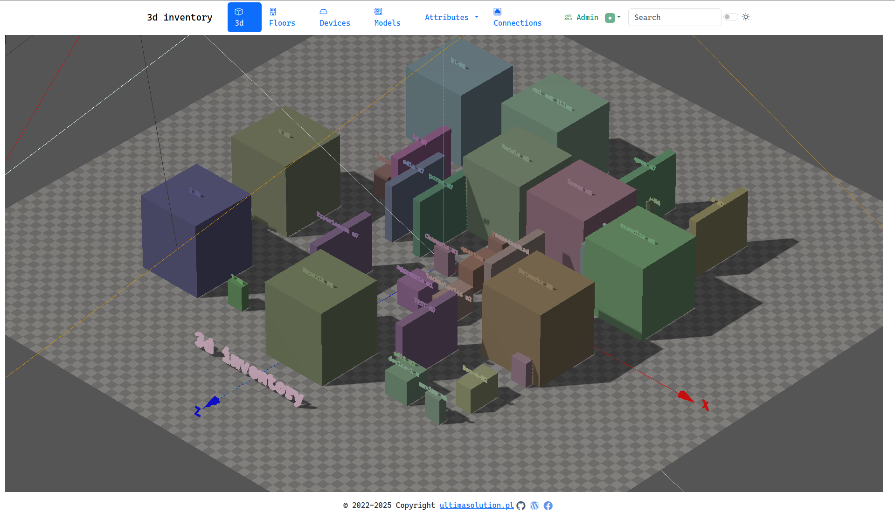

## 🚀 About Me

Senior information security and Oracle specialist with more than 20 years of experience designing, building, and operating systems across banking and telecommunications. At Citi, I work as an Assistant Vice President and Senior Information Security Analyst. Earlier at IBM, I contributed to Node.js APIs for Hyperledger Fabric projects and SAP ABAP HR applications.

I combine Oracle Database 19c and PL/SQL expertise with application security, full-stack development, cloud deployment, and operational reliability. I build systems that are secure, maintainable, and practical for real-world use.

- 🏢 **Current Role:** Assistant Vice President / Senior Information Security Analyst at Citi
- 🛠️ **Technical Skills:** Oracle Database 19c, PL/SQL, SQL, ETL, Oracle Forms; Python, Node.js, Angular, Three.js, Java, SAP ABAP, REST APIs; MongoDB, PostgreSQL; application security; GCP, AWS, Kubernetes; Jenkins, GitHub Actions, JIRA
- 🎓 **Education:** Master’s degree in Informatics from Warsaw University of Technology
- 🌍 **Location:** Mazowieckie, Poland (prefer remote work)

## 🧑‍💻 Projects

 Source code requires access.  Project information is publicly available.

### 3D Inventory System

I designed and built **3D Inventory**, a full-stack application for managing warehouse and data-center assets visually and operationally. The Angular interface presents an interactive 3D floor view, while a Node.js/Express API manages inventory data in MongoDB.

It is designed for teams that need to record devices and models, map spatial positions and connections, maintain flexible metadata, control permissions, and review who changed each record. A parameterized attribute dictionary supports assets that require different properties without changing the base database model.

**Potential users:**

- Data-center, network, and infrastructure teams mapping racks and equipment
- Warehouse operations teams organizing locations and tracked assets
- Asset-management and compliance teams reviewing change history
- Administrators maintaining users, roles, permissions, and backups
- Developers and system integrators consuming the Swagger/OpenAPI REST API

**Core functionality:**

- Interactive Three.js floor and equipment visualization
- CRUD operations for devices, models, floors, connections, attributes, and attribute dictionaries
- Individual and bulk device creation
- JWT authentication and role-based access with owner-aware editing
- Super-admin, administrator, user, and viewer workflows
- Before/after audit logs, login history, filtering, and user context
- Google sign-in, reCAPTCHA protection, backup and restore, and texture management
- Dockerized UI/API deployment, health checks, CI quality gates, and Google Cloud Run support

**My role:** product and architecture, database modeling, backend and frontend development, security controls, audit logging, testing, containerization, and Google Cloud deployment.

- **Source:** [Angular UI](https://github.com/karol-preiskorn/3d-inventory-angular-ui)  · [MongoDB API](https://github.com/karol-preiskorn/3d-inventory-mongo-api) 
- **Live demo:** [3D Inventory UI](https://d-inventory-ui-wzwe3odv7q-ew.a.run.app)
- **API docs:** [Swagger UI](https://d-inventory-api-wzwe3odv7q-ew.a.run.app/doc)
- **Demo video:** [YouTube](https://youtu.be/rNOxpZ0ti1Q)
- **Details:** [Project overview](https://ultimasolution.pl/data-center-inventory-software/)
- **Documentation:**  [System overview](./src/3d-inventory/README.md) · [Potential users](./src/3d-inventory/use-cases.md) · [Functionality](./src/3d-inventory/features.md) · [Architecture and security](./src/3d-inventory/architecture.md)

### Forex Dukascopy trading client

Built a Python analysis and automation toolkit for exploring Dukascopy market data. It fetches and caches prices, computes indicators and signals, and provides a Dash dashboard for monitoring activity. Trade management combines ATR-based position sizing and exits with budget constraints and Ichimoku confirmation; a background monitor checks open positions independently of dashboard refreshes.

- **Source:** [GitHub repository](https://github.com/karol-preiskorn/forex) 
- **Details:** [Project overview](https://ultimasolution.pl/forex-dukascopy-trading-client/)

### Java loan REST API

A Spring Boot REST API for issuing and extending fixed-term loans. I used SQLite and sample data to keep local development simple.

- **Source:** [GitHub repository](https://github.com/karol-preiskorn/LoanREST) 
- **Details:** [Project overview](https://ultimasolution.pl/loan-rest-api/)

### Blockchain in Java

A Java learning project that models how wallets, transactions, and blocks form a verifiable ledger. I implemented proof-of-work block linking, ECDSA-signed transactions, and a UTXO ledger that derives balances from unspent outputs, with validation for chain and transaction integrity.

- **Source:** [GitHub repository](https://github.com/karol-preiskorn/java-blockchain) 
- **Details:** [Project overview](https://ultimasolution.pl/blockchain-in-java/)

## 📫 How to reach me

For questions, collaboration, or project discussions, please contact me through: 
