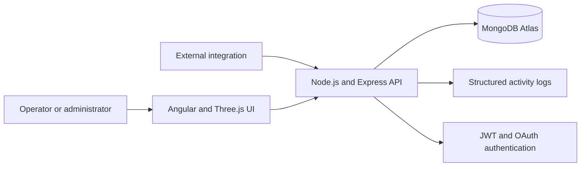

# Architecture and Security

## System architecture

The Angular UI is responsible for interactive inventory workflows and 3D presentation. The TypeScript API is responsible for persistence, validation, authentication, authorization, and audit records. MongoDB stores the inventory collections and flexible attribute data.

## Data model

The data model separates reusable and operational concepts:

- Users and roles control access.
- Devices belong to floors and reference models.
- Devices may have attributes and connections.
- Attribute dictionaries define supported metadata.
- Logs record operations and login events.

This design allows metadata to evolve without introducing a new collection or rigid schema field for every asset type.

## Security boundaries

Security checks are enforced by both the UI and API:

- UI guards control navigation and available actions.
- API middleware validates requests and enforces permissions.
- Passwords are hashed and account failures can trigger lockout.
- JWT sessions are validated by protected endpoints.
- Google sign-in uses OAuth credentials and callback handling.
- Google reCAPTCHA v3 protects selected authentication workflows.
- Rate limiting and input validation reduce abuse and malformed requests.
- Helmet and CORS configuration provide HTTP and cross-origin protections.
- TLS certificate validation is strict by default.

The UI experience is not the security boundary. Every sensitive operation must still be rejected or allowed by the API.

## Backup and recovery

Backup and restore operations are restricted to super-admin users. Backup data can be encrypted with an AES-256 key, and secret and database credentials should be managed outside source control.

## Deployment

Both applications are containerized and can be deployed to Google Cloud Run. The frontend communicates with the API through a development proxy or a configured production API URL.

Deployment practices include:

- Health checks
- Docker multi-stage builds
- Environment-based configuration
- HTTPS
- CI quality gates
- Automated build and deployment workflows
